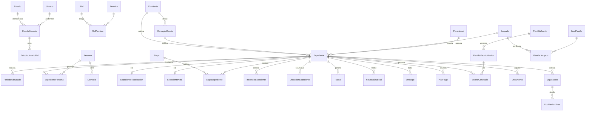

# Procu360 — Modelo de datos

> Versión 0.3 · 09/11/2026 · Incorpora las decisiones del 09/11/2026 (§10)
> Fuente única: script `LegisProcessDBMonitorio` (52 tablas con DDL, 27 vistas, procedimientos), el único disponible. La base Access `ESTUDIO` **no** se considera. Los procedimientos almacenados son referencia secundaria: pueden diferir del código y no se toman como especificación.
> Este documento acompaña a los scripts generados `db/sql/01-esquema.sql`, `db/sql/02-datos-prueba.sql` y `db/sql/03-seguridad-rls.sql`. Ante cualquier diferencia, manda el script.

## 1. Entregables

| Archivo | Contenido |
|---|---|
| `db/sql/01-esquema.sql` | 7 esquemas, 70 tablas, claves primarias, únicas, foráneas compuestas por Estudio, `CHECK`, índices, descripción de cada tabla (`MS_Description`), roles de base de datos y procedimientos (`seg.usp_SiguienteNumero`, `aud.usp_PurgarAuditoria`) |
| `db/sql/02-datos-prueba.sql` | 2.959 filas de prueba para **todas** las tablas, de **dos Estudios**, en una transacción (ver §9) |
| `db/sql/03-seguridad-rls.sql` | Row-Level Security: política `seg.PoliticaEstudio` sobre las 59 tablas por Estudio y la auditoría |
| `db/gen/esquema.py` | Definición única del modelo (de aquí salen DDL, RLS y la validación) |
| `db/gen/datos.py` | Generador determinístico de los datos de prueba |
| `db/gen/build.py` | Genera los tres scripts y valida los datos en una base SQLite en memoria: claves foráneas, únicas, `CHECK` y 9 reglas de negocio |

Orden de ejecución sobre una base vacía: `01` → `02` → `03`. Para regenerar: `python db/gen/build.py`.

> Los scripts se validaron estructuralmente (SQLite con claves compuestas y restricciones) pero **no se ejecutaron sobre SQL Server** en este entorno. Primer paso del equipo: correrlos en un SQL Server 2019+ local o en contenedor.

## 2. Convenciones

| Tema | Convención |
|---|---|
| Motor | SQL Server 2019+ / Azure SQL |
| Nombres | Español, PascalCase, singular |
| Esquemas | `seg` seguridad y tenants · `cat` catálogos compartidos · `conf` configuración del Estudio · `dbo` núcleo · `liq` liquidación · `aud` auditoría · `mig` migración |
| Clave primaria | `Id int` (catálogos) o `bigint` (transaccionales) `IDENTITY`. Se abandona el `uniqueidentifier NEWID()` clustered de Monitorio |
| Tenant | `EstudioId int NOT NULL` en toda tabla por Estudio + `UNIQUE (EstudioId, Id)` |
| FK entre tablas por Estudio | Compuestas `(EstudioId, XxxId) → (EstudioId, Id)`: la base impide referenciar un registro de otro Estudio |
| FK a tablas globales | Simples (`seg.Usuario`, `cat.*`) |
| Importes / tasas / JUS | `decimal(18,2)` / `decimal(12,6)` en tanto por uno / `decimal(9,2)` |
| Fechas | Negocio `date`; técnicas `datetime2(3)` UTC con sufijo `Utc` |
| Enumeraciones | `tinyint` con `CHECK` y significado en la descripción de la tabla |
| Columnas base | `CreadoUtc`, `CreadoPor`, `ModificadoUtc`, `ModificadoPor`, `Version rowversion` (concurrencia optimista) |
| Baja lógica | `Anulado`, `AnuladoUtc`, `AnuladoPor`, `MotivoAnulacion` en `Expediente` y `Persona`; `Activo/Activa` en catálogos |
| Trazabilidad de migración | `LegadoId uniqueidentifier` = GUID de Monitorio, con índice único filtrado por Estudio. Reemplaza a una tabla de mapeo aparte |
| Borrado | Sin `ON DELETE CASCADE` en ninguna FK |

## 3. Diagrama del núcleo



## 4. Aislamiento por Estudio

Tres barreras independientes:

1. **Claves compuestas**: toda FK entre tablas por Estudio incluye `EstudioId`. Un expediente del Estudio 1 no puede apuntar a un juzgado del Estudio 2 aunque el código tenga un error.
2. **Filtro global de EF Core** por el Estudio activo.
3. **Row-Level Security** (`03-seguridad-rls.sql`):
   - `seg.fn_FiltroEstudio(EstudioId)`: visible si coincide con `SESSION_CONTEXT('EstudioId')` o si el usuario de base es miembro de `rol_plataforma`.
   - `seg.fn_FiltroMembresia(EstudioId, UsuarioId)`: en `seg.EstudioUsuario` además deja ver **las membresías propias** en cualquier Estudio, para poder elegir Estudio al iniciar sesión (`SESSION_CONTEXT('UsuarioId')`).
   - Predicados de bloqueo `AFTER INSERT` y `AFTER UPDATE`: no se puede escribir ni mover un registro a otro Estudio.
   - La aplicación fija ambos valores con `sp_set_session_context ... @read_only = 1` al abrir cada conexión (interceptor de EF Core).

Roles de base de datos:

| Rol | Uso | Permisos |
|---|---|---|
| `rol_aplicacion` | Usuario con que corre la web | Lectura/escritura en `dbo`, `conf`, `liq`, `seg`, `mig`; solo lectura en `cat`; en `aud` **solo `INSERT` y `SELECT`** (`DENY UPDATE, DELETE`) |
| `rol_plataforma` | Migración, alta de Estudios, purga de auditoría | Atraviesa RLS. Nunca lo usa la web |

Retención de auditoría: `seg.Estudio.RetencionAuditoriaDias` (por defecto 365, entre 30 y 3650). `aud.usp_PurgarAuditoria` (job diario con `rol_plataforma`) borra en lotes los eventos vencidos de cada Estudio, usa 730 días para los de plataforma y registra cuántos borró. Los documentos no tienen retención automática: `dbo.Documento` exige usuario, fecha y motivo para marcarlos eliminados.

## 5. Decisiones de modelado

- **Expediente con estado desnormalizado.** `EtapaActualId`, `CautelarActualId`, `InstanciaActualId`, `UbicacionActualId` y `FechaUltimoMovimiento` se actualizan en la misma transacción que registra el movimiento. Reemplazan las ~30 subconsultas `TOP 1` por fila de `V_Expedientes`, principal causa de lentitud del listado.
- **Un solo objeto de deuda por expediente** (`NroCuenta`, `Nomenclatura`, `Dominio`, `Designacion`, `MatriculaRpi`), como en Monitorio (confirmado). No hay tabla de cuentas.
- **Datos de fiscalización y de actas en tablas 1:1** (`ExpedienteFiscalizacion`, `ExpedienteActa`): son 25 columnas que en Monitorio están vacías en la mayoría de los expedientes.
- **Un solo catálogo de etapas** (`conf.Etapa`) con `Flujo` 1 principal / 2 cautelar, y un solo historial (`dbo.EtapaExpediente`). Unifica `Etapa`/`Cautelar` y `EtapaExpediente`/`CautelarExpediente`, que tenían la misma estructura.
- **`HitoSistema`** marca la etapa de inicio de demanda, demanda presentada, sentencia y ejecución. Reemplaza el código `'M100'` fijo en `frmPlanilla.cs`, `Configuracion.DemPresID` y los GUID fijos de `sp_V_Expedientes_GetInformePF`.
- **`EsDiligencia`** en `conf.Etapa` (nuevo) distingue cédulas y oficios dentro del flujo, para la línea de tiempo y los listados.
- **Embargo**: columnas comunes + `DetalleJson` con los datos propios de cada clase (las 33 columnas de `EmbargoExpediente` están vacías salvo las de su tipo). Se agregan estado y fechas de solicitud, traba y levantamiento.
- **Tareas**: `ActividadAdministrativaExpediente` (tareas del expediente) y `Agenda` (agenda personal) se unifican en `dbo.Tarea`; `Origen` conserva de dónde vino.
- **Liquidaciones guardadas** (`liq.Liquidacion` + `liq.LiquidacionLinea`) son nuevas: Monitorio armaba la planilla en Excel y no la guardaba. `ParametrosJson` congela los valores usados.
- **Parámetros de liquidación por comitente y con vigencia**: `liq.ParametroLiquidacion`, `liq.TasaInteres` y `liq.EscalaHonorarios` aceptan `ComitenteId` NULL (valor general del Estudio) o un comitente (prevalece). Reemplazan `UnidadPlanilla`, valores de `App.config` y constantes de `frmPlanilla.cs`.
- **Organización judicial por Estudio** (`conf.Juzgado`), copiable al crear un Estudio (`seg.Estudio.EstudioOrigenCopiaId` y `CopiaCatalogosJson`).
- **Permisos propios de Procu360.** El esquema de accesos del WinForms (`MenuSistema`, `MenuPerfil`, `Perfil`, `PerfilUsuario`) se descarta. Cada Estudio arranca con los roles sugeridos (Administrador, Abogado / Procurador, Gestor, Liquidaciones, Solo lectura, Auditor) y la matriz módulo × acción de `seg.Permiso`.
- **Auditoría nueva.** `aud.AuditoriaEvento` reemplaza a `LogSistema`, que no se migra: el historial anterior queda en el respaldo de Monitorio.
- **Usuarios globales, membresías por Estudio.** `seg.Usuario` es la tabla de ASP.NET Core Identity con clave `int`; `seg.EstudioUsuario.Estado = 2` (pendiente de aprobación) cubre la aprobación del superadministrador para usuarios que ya pertenecen a otro Estudio.
- **Integraciones fuera**: no se modelan `KLKWSLog`, `LogExportacion`, `Exportacion`, `AFC`, `EstandarEtapa`, `PJ_*` ni las columnas `ItaxID`, `MuniCordobaID`, `JusticiaCordobaId`, `Itax`, `ExportadoLegisProcess`, `ExportadoJusticiaCordoba`, `JusticiaCba`, `RolLocalizacionXML`, `RolAFCXML`.

## 6. Tablas

Columnas completas, tipos y restricciones en `db/sql/01-esquema.sql`. Se omiten aquí `Id`, `EstudioId`, `LegadoId`, columnas base y de baja lógica.

### 6.1 Seguridad y tenants (`seg`)

| Tabla | Columnas de negocio | Origen Monitorio | Notas |
|---|---|---|---|
| `Estudio` | Nombre, Cuit, Estado, ZonaHoraria, RetencionAuditoriaDias, EstudioOrigenCopiaId, CopiaCatalogosJson | Nueva | Raíz del tenant. Estado 1 activo, 2 suspendido. CopiaCatalogosJson registra qué catálogos se copiaron del Estudio origen al crearlo. |
| `Usuario` | Email, EmailNormalizado, Nombre, Apellido, EsSuperAdmin, Activo, MfaHabilitado, PasswordHash, SecurityStamp, BloqueadoHastaUtc, AccesosFallidos, UltimoAccesoUtc | Usuario (sin Pass) | Identidad global (IdentityUser<int> de ASP.NET Core Identity con columnas propias). Sin EstudioId. Las contraseñas del legado NO se migran: PasswordHash queda NULL hasta que el usuario acepta la invitación. · LegadoId |
| `EstudioUsuario` | UsuarioId, Estado, ProfesionalId, InvitadoPor, InvitadoUtc, AprobadoPor, AprobadoUtc, MotivoRechazo, UltimoAccesoUtc | Nueva | Membresía. Estado 1 invitado, 2 pendiente de aprobación (el email ya pertenece a otro Estudio), 3 activo, 4 desactivado, 5 rechazado. |
| `Rol` | Nombre, Descripcion, Ambito, EsSistema | Nueva (Perfil de Monitorio se descarta) | Ámbito 1 todo el Estudio, 2 por comitente, 3 expedientes asignados. |
| `Permiso` | Codigo, Modulo, Accion, Descripcion | Nueva | Global, definido por el código de la aplicación (modulo.accion). Reemplaza el esquema de menús del WinForms (MenuSistema/MenuPerfil), que se descarta. |
| `RolPermiso` | RolId, PermisoId | Nueva |  |
| `EstudioUsuarioRol` | EstudioUsuarioId, RolId, ComitenteId | Nueva |  |
| `SecuenciaEstudio` | Nombre, UltimoValor | Secuencia | Numeración por Estudio (NroOrden). Se incrementa con UPDLOCK, HOLDLOCK dentro de la transacción de alta. |
| `AccesoSoporte` | UsuarioId, Motivo, DesdeUtc, HastaUtc, OtorgadoPor | Nueva | Acceso temporal y auditado de un superadministrador a los datos de un Estudio. |
| `TrabajoProceso` | Tipo, Estado, Total, Procesados, Errores, ParametrosJson, ResultadoJson, IniciadoUtc, FinalizadoUtc | Nueva | Procesos en segundo plano. Tipo 1 escritos masivos, 2 carga masiva, 3 modificación masiva, 4 importar novedades, 5 liquidación masiva, 6 purga de auditoría. Estado 1 en cola, 2 en curso, 3 finalizado, 4 finalizado con errores, 5 cancelado. |

### 6.2 Catálogos compartidos de plataforma (`cat`)

| Tabla | Columnas de negocio | Origen Monitorio | Notas |
|---|---|---|---|
| `Provincia` | Nombre, Codigo | Provincia | · LegadoId |
| `Localidad` | ProvinciaId, Nombre, CodigoPostal | Localidad | · LegadoId |
| `TipoDocumento` | Nombre, Codigo | TipoDoc | · LegadoId |
| `CondicionIva` | Nombre, Porcentaje, LetraComprobante, EsResponsableInscripto, EsNoResponsable, EsExento, EsMonotributo, EsConsumidorFinal | Iva | · LegadoId |
| `Feriado` | Fecha, Descripcion, Ambito, ProvinciaId | Feriado | Ámbito 1 nacional, 2 provincial, 3 judicial (receso). · LegadoId |
| `IndiceTasaPasiva` | Fecha, Coeficiente | AlicuotaPlanilla | Coeficiente acumulado diario de tasa pasiva (BCRA). Lo mantiene el superadministrador. |
| `ActividadEconomica` | Codigo, Nombre | Actividad | Nomenclador público de actividades (IIBB). · LegadoId |

### 6.3 Configuración del Estudio (`conf`)

| Tabla | Columnas de negocio | Origen Monitorio | Notas |
|---|---|---|---|
| `Comitente` | Nombre, Cuit, Domicilio, CodigoPostal, LocalidadId, Observaciones, Activo | DomicilioDGR | Acreedor/organismo para el que se procura (municipio, DGR, ente). Las fórmulas de liquidación se parametrizan por comitente. · LegadoId |
| `ConceptoDeuda` | ComitenteId, Nombre, Item, PeriodosDiferenciados, ConsideraPeriodos, PeriodosFormatoDGR, TextoEscrito, Activo | Impuesto | Impuesto/tasa reclamada. TextoEscrito admite variables {{...}}. · LegadoId |
| `Profesional` | Nombre, Cuit, Matricula, CondicionIvaId, Calle, Numero, Barrio, LocalidadId, Carpeta, Descripcion, EsProcurador, EsPatrocinante, EsApoderado, EsAbogadoInterior, … (+5) | Procurador (sin UsuarioGant/PasswordGant) | Procuradores, patrocinantes, apoderados, abogados de interior y martilleros. Reemplaza al ProcuradorID que el legado usaba como tenant parcial. · LegadoId |
| `ConfiguracionEstudio` | Clave, Valor, Tipo | Configuracion | Parámetros generales no modelados como columna. Tipo 1 texto, 2 entero, 3 decimal, 4 fecha, 5 booleano. |
| `FeriadoEstudio` | Fecha, Descripcion | Nueva | Asuetos propios del Estudio o de su circunscripción. |
| `Juzgado` | Nombre, Descripcion, Secretaria, Juez, Ubicacion, Telefono, EsCapital, LocalidadId, DomicilioParaEscritos, Orden, Activo | Juzgado (sin ItaxID ni MuniCordobaID) | Organización judicial por Estudio; al crear un Estudio puede copiarse de otro. · LegadoId |
| `Instancia` | Nombre, Color, Perime, EsBaja, Orden, Activa | Instancia | Macroestado del expediente (pre judicial, judicial, con sentencia, archivado…). · LegadoId |
| `Etapa` | Flujo, Codigo, Nombre, Orden, Dias, DiasHabiles, Interrumpe, CortaPerencion, EsMonitorio, EsEjecucion, EsDiligencia, EtapaAnteriorId, EtapaSiguienteId, PasaSiguienteAutomatica, … (+4) | Etapa + Cautelar | Flujo 1 principal, 2 cautelar. HitoSistema 1 inicio de demanda, 2 demanda presentada (reemplaza el código fijo M100 y Configuracion.DemPresID), 3 sentencia, 4 ejecución. TareaParaUsuarios 0 ninguno, 1 responsable, 2 usuarios seleccionados, 3 todos. · LegadoId |
| `EtapaUsuarioNotificado` | EtapaId, UsuarioId | EtapaAgendaUsuario |  |
| `TipoTarea` | Nombre, Dias, DiasHabiles, Activo | ActividadAdministrativa | · LegadoId |
| `Ubicacion` | Nombre, Activa | Lugar | Ubicación física del expediente. · LegadoId |
| `Region` | Nombre | Expediente.Region (valores distintos) |  |
| `Campania` | Numero, Nombre | Expediente.NroCampania/NombreCampania, ExpedienteCodigoDevolucion.Campania |  |
| `TipoEmbargo` | Nombre, Clase, Observaciones | TipoEmbargo | Clase 1 inmueble, 2 automotor, 3 embargo de cuentas corrientes, 4 inhibición, 5 intervención de caja, 6 reserva de cautelar. La clase define el esquema de DetalleJson del embargo. · LegadoId |
| `RegistroPublico` | Nombre, Domicilio, Zona | Registro | · LegadoId |
| `Infraccion` | Codigo, Nombre, Descripcion | Infraccion | · LegadoId |
| `CodigoDevolucion` | Codigo, Descripcion | CodigoDevolucion | · LegadoId |
| `PlantillaEscrito` | Nombre, Tipo, EtapaId, InstanciaId, EsUnico, Activa | EtapaEscrito, Instancia.Path/EscritoNombre, Cautelar.Path/EscritoNombre | Tipo 1 escrito, 2 cédula, 3 carta, 4 oficio. EsUnico: se genera una sola vez por expediente. · LegadoId |
| `PlantillaEscritoVersion` | PlantillaEscritoId, NroVersion, DocumentoId, Notas, Vigente | Nueva |  |

### 6.4 Núcleo (`dbo`)

| Tabla | Columnas de negocio | Origen Monitorio | Notas |
|---|---|---|---|
| `Expediente` | NroOrden, ComitenteId, ConceptoDeudaId, NroLiquidacion, FechaTitulo, FechaAlta, MontoTitulo, MontoCapital, NroCuenta, Nomenclatura, Dominio, Designacion, MatriculaRpi, DomicilioObjeto, … (+35) | Expediente (columnas generales) | Título de deuda + causa judicial. Las columnas de estado actual reemplazan las ~30 subconsultas TOP 1 de V_Expedientes. · baja lógica, LegadoId |
| `ExpedienteFiscalizacion` | ExpedienteId, TipoFisca, Tipo, NroExpediente, NroOrden, NroResolucion, NroRecursoReconsideracion, ResolFechaResolucion, ResolFechaNotificacion, ReconFechaResolucion, ReconFechaNotificacion, ContenFechaDemanda, ContenFechaApelacion, ContenFechaDemandaContenciosa, … (+5) | Expediente.Fisca* | 1:1 opcional. Solo para expedientes de fiscalización (EsFisca). |
| `ExpedienteActa` | ExpedienteId, FechaLabrado, HoraLabrado, LugarLabrado, TipoYNroLicencia, DescripcionDominio, NroCaso, JuzgadoFaltas, NroTramite, FechaTramite | Expediente (FechaLabrado…FechaTramite) | 1:1 opcional. Actas de infracción (multas). |
| `ExpedienteInfraccion` | ExpedienteId, InfraccionId, Fecha | InfraccionExpediente | · LegadoId |
| `ExpedienteActividad` | ExpedienteId, ActividadEconomicaId | ExpedienteActividad + Expediente.ActividadIIBB/CodigoActividadIIBB | · LegadoId |
| `PeriodoAdeudado` | ExpedienteId, Anio, Cuota, Concepto, Vencimiento, Tributo, Recargo, Observaciones | ExpedientePeriodo | Reemplaza también al texto Expediente.Periodos, que se arma a partir de esta tabla. · LegadoId |
| `Persona` | EsPersonaFisica, Apellido, Nombre, RazonSocial, TipoDocumentoId, NroDocumento, Cuit, Sexo, FechaNacimiento, Telefono1, Telefono2, Email, Observaciones | Persona | · baja lógica, LegadoId |
| `Domicilio` | PersonaId, Tipo, Calle, Numero, Piso, Depto, Barrio, CodigoPostal, LocalidadId, Principal | Domicilio | Tipo 1 real, 2 fiscal, 3 constituido, 4 postal. Un solo principal por persona (índice filtrado). · LegadoId |
| `ExpedientePersona` | ExpedienteId, PersonaId, Rol, Posicion | ExpedientePersona (+ Expediente.PersonaID) | Rol 1 demandado, 2 codemandado, 3 responsable solidario. Sin límite de codemandados. · LegadoId |
| `InformePersona` | PersonaId, Fecha, Texto | Informe | · LegadoId |
| `EtapaExpediente` | ExpedienteId, EtapaId, FechaInicio, FechaFin, FechaVencimiento, Estado, Monto, Observaciones | EtapaExpediente + CautelarExpediente | Historial de etapas de ambos flujos. Estado 1 alta, 2 cumplimentada, 3 suspendida, 4 baja (en el legado 0 = alta). FechaVencimiento se calcula con días hábiles y feriados. · LegadoId |
| `InstanciaExpediente` | ExpedienteId, InstanciaId, Fecha | InstanciaExpediente | · LegadoId |
| `UbicacionExpediente` | ExpedienteId, UbicacionId, Fecha | ExpedienteLugar | · LegadoId |
| `Tarea` | ExpedienteId, TipoTareaId, Titulo, Descripcion, Lugar, FechaInicio, FechaVencimiento, HoraInicio, HoraFin, TodoElDia, Alerta, RepetirHasta, ResponsableUsuarioId, VisibleParaTodos, … (+4) | ActividadAdministrativaExpediente + Agenda | Estado 1 pendiente, 2 cumplida, 3 archivada, 4 anulada. Origen 1 manual, 2 generada por etapa, 3 desde novedad, 4 migrada de Agenda. · LegadoId |
| `TareaParticipante` | TareaId, UsuarioId | AgendaUsuario |  |
| `NovedadJudicial` | ExpedienteId, NroExpedienteInformado, Fecha, Texto, Fuente, Leida, LeidaUtc, LeidaPor, TareaId | ExpedienteParte | Proveídos, decretos y partes. Fuente 1 manual, 2 importación de archivo, 3 migrada. ExpedienteId NULL = pendiente de vincular. · LegadoId |
| `Embargo` | ExpedienteId, TipoEmbargoId, Estado, FechaSolicitud, FechaTraba, FechaLevantamiento, Monto, Porcentaje, RegistroPublicoId, NroRegistro, DireccionRegistro, Secretaria, Autorizados, Dominio, … (+4) | EmbargoExpediente | Estado 1 solicitado, 2 trabado, 3 levantado, 4 sin efecto (nuevo: el legado no tenía estado; se migra como 2). DetalleJson guarda los datos propios de cada clase (marca, modelo, chasis, sticker; lote, manzana, PH; banco, CBU; etc.). · LegadoId |
| `PlanPago` | ExpedienteId, NroPlan, FechaPlan, PeriodosIncluidos, CantCuotas, CuotasPagadas, CuotasVencidasImpagas, CuotasAVencer, FechaCaducidad, Estado, FechaConsulta, Decreto, Activo | ExpedientePlanPago (+ Expediente.NroPlanPagos) | Estado es texto libre, como EstadoPlan en Monitorio. Activo indica el plan vigente del expediente. · LegadoId |
| `Requerimiento` | ExpedienteId, Fecha, Descripcion, Enviado, EnFolio | Requerimiento | · LegadoId |
| `EstudioTitulo` | ExpedienteId, Fecha, Descripcion, Pedido, EnFolio | EstudioTitulo | · LegadoId |
| `DevolucionCorreo` | ExpedienteId, CodigoDevolucionId, Fecha, CampaniaId, NroCaso, UsuarioId | ExpedienteCodigoDevolucion | · LegadoId |
| `Documento` | ExpedienteId, Tipo, NombreArchivo, ContentType, TamanioBytes, Sha256, RutaAlmacenamiento, Descripcion, Eliminado, EliminadoUtc, EliminadoPor, MotivoEliminacion | Nueva | Tipo 1 adjunto, 2 escrito generado, 3 liquidación exportada, 4 plantilla, 5 importación. Contenido en almacenamiento de archivos con prefijo de Estudio; sin borrado automático: se conserva hasta que un usuario con permiso lo elimina. |
| `EscritoGenerado` | ExpedienteId, PlantillaEscritoVersionId, EtapaId, InstanciaId, TrabajoProcesoId, UsuarioId, FechaUtc, DocumentoId, Estado | ExpedienteEtapaEscrito + ExpedienteInstanciaEscrito | Estado 1 generado, 2 presentado, 3 anulado. Los migrados no tienen documento (el legado no lo guardaba). · LegadoId |

### 6.5 Liquidación (`liq`)

| Tabla | Columnas de negocio | Origen Monitorio | Notas |
|---|---|---|---|
| `ParametroLiquidacion` | ComitenteId, Codigo, Valor, ValorFecha, VigenteDesde, VigenteHasta, Observaciones | UnidadPlanilla + valores de App.config + constantes en frmPlanilla.cs | Parámetros con vigencia. ComitenteId NULL = valor general del Estudio; con ComitenteId = particular del comitente (tiene prioridad). |
| `TasaInteres` | ComitenteId, Codigo, Periodicidad, Valor, VigenteDesde, VigenteHasta | Nueva | Periodicidad 1 diaria, 2 mensual, 3 anual. Valor en tanto por uno (0.000830 = 0,083 %). Reemplaza 0,083 % y 0,1 % diarios fijos en código. |
| `EscalaHonorarios` | ComitenteId, VigenteDesde, BaseDesde, BaseHasta, Porcentaje | Nueva | Tramos de la escala (9 % … 3 % en el legado, fijos en código). |
| `RubroPlanilla` | Nombre, Descripcion, DescripcionTotal, Orden, PadreId | RubroPlanilla | · LegadoId |
| `ItemPlanilla` | RubroPlanillaId, Nombre, Descripcion, TipoCalculo, Valor, EsPorcentaje, MontoMinimo, CargaManual, EsSubtotal, EsDefault, OrdenDefault, Activo | ItemsPlanilla | TipoCalculo reemplaza las 9 columnas Es*: 1 monto fijo, 2 porcentaje del capital, 3 capital, 4 interés simple, 5 tasa pasiva, 6 interés sobre capital, 7 honorarios, 8 tasa de justicia, 9 aportes, 10 gastos de diligencias, 11 subtotal. · LegadoId |
| `ItemPlanillaTope` | ItemPlanillaId, VigenteDesde, VigenteHasta, Minimo, Maximo | ItemsMontoMinMax (IemsMontoMinMax se descarta tras comparar contenido) | · LegadoId |
| `PlanillaJuzgado` | JuzgadoId, ItemPlanillaId, Orden | JuzgadoItems |  |
| `Liquidacion` | ExpedienteId, NroVersion, FechaCalculo, Estado, JuzgadoId, TotalCapital, TotalInteres, TotalGastos, HonorariosJus, HonorariosPesos, Total, ParametrosJson, DocumentoId | Nueva | Nueva: el legado no guardaba planillas. Estado 1 borrador, 2 guardada, 3 presentada, 4 anulada. ParametrosJson copia los valores usados para que sea reproducible. |
| `LiquidacionLinea` | LiquidacionId, Orden, RubroPlanillaId, ItemPlanillaId, Concepto, PeriodoAdeudadoId, Base, Tasa, Dias, Importe, EsManual, Detalle | Nueva |  |

### 6.6 Auditoría (`aud`)

| Tabla | Columnas de negocio | Origen Monitorio | Notas |
|---|---|---|---|
| `AuditoriaEvento` | UsuarioId, FechaUtc, Modulo, Entidad, EntidadId, Accion, Resultado, CambiosJson, TrabajoProcesoId, CorrelacionId, Ip, UserAgent | Nueva: reemplaza a LogSistema, que no se migra | Solo inserción. EstudioId NULL = evento de plataforma. Accion 1 crear, 2 editar, 3 anular, 4 eliminar, 5 cambiar estado, 6 calcular, 7 generar, 8 exportar, 9 login, 10 login fallido, 11 logout, 12 cambiar permisos, 13 aprobar membresía, 14 acceso de soporte. Resultado 1 ok, 2 rechazado, 3 error. |

### 6.7 Migración (`mig`)

| Tabla | Columnas de negocio | Origen Monitorio | Notas |
|---|---|---|---|
| `DatoARevisar` | Tipo, Entidad, EntidadId, TablaOrigen, ClaveOrigen, Campo, ValorOriginal, ValorPropuesto, Estado, ResueltoPor, ResueltoUtc, Comentario | Nueva | Cola de la pantalla Datos a revisar. Estado 1 pendiente, 2 resuelto, 3 descartado. |

## 7. Mapeo Monitorio → Procu360

### 7.1 Tablas

| Monitorio | Procu360 | Transformación |
|---|---|---|
| `Expediente` | `dbo.Expediente` | `CodigoBarra` → `NroExpedienteJudicial`; `Monto` (texto) → `MontoTitulo` decimal, no numéricos → `mig.DatoARevisar`; `ObsExpediente` → `Observaciones`; `Observaciones` → `ObservacionesTitulo`; `ImpuestoID` → `ConceptoDeudaId`; `DireccionDGRID` → `ComitenteId`; `Domicilio`/`LocalidadID` → `DomicilioObjeto`/`LocalidadObjetoId`; `Registro` (texto) → `RegistroPublicoId` por coincidencia; `Region`, `NroCampania`/`NombreCampania` → `conf.Region`, `conf.Campania` |
| ↳ `Fisca*`, `TipoFisca`, `Tipo` | `dbo.ExpedienteFiscalizacion` | Solo si `EsFisca = 1` o alguna columna tiene dato |
| ↳ `FechaLabrado` … `FechaTramite` | `dbo.ExpedienteActa` | Solo si alguna columna tiene dato |
| ↳ `PersonaID` | `dbo.ExpedientePersona` (Rol 1) | Si no existe ya en `ExpedientePersona` |
| ↳ `NroPlanPagos` | `dbo.PlanPago` | Si no hay plan con ese número; si no, `DatoARevisar` |
| ↳ `ActividadIIBB`, `CodigoActividadIIBB` | `dbo.ExpedienteActividad` | Buscar en `cat.ActividadEconomica` por código |
| ↳ `Lugar` (texto) | `dbo.UbicacionExpediente` | Solo si no hay historial en `ExpedienteLugar` |
| ↳ `Periodos` (texto) | — | Se descarta: se arma desde `PeriodoAdeudado` |
| `ExpedientePeriodo` | `dbo.PeriodoAdeudado` | `Tributo`, `Recargo` igual; `Cuota` a 50 caracteres |
| `Persona` | `dbo.Persona` | `PersonaFisica` → `EsPersonaFisica`; `Sexo bit` → `'F'/'M'`; `NroCuit` → `Cuit`; `TipoDoc` → `TipoDocumentoId` |
| `Domicilio` | `dbo.Domicilio` | `Tipo = 1` (real); `CP` → `CodigoPostal` |
| `ExpedientePersona` | `dbo.ExpedientePersona` | `Demandado = 1` → Rol 1, si no Rol 2; `Posicion` por orden de alta |
| `Informe` | `dbo.InformePersona` | |
| `Etapa` | `conf.Etapa` (Flujo 1) | `GeneraAgenda` → `GeneraTarea`; `ParaUsuarios`/`MostrarATodos` → `TareaParaUsuarios`; `Codigo = 'M100'` y `Configuracion.DemPresID` → `HitoSistema = 2` |
| `Cautelar` | `conf.Etapa` (Flujo 2) | `Path`/`EscritoNombre` → `conf.PlantillaEscrito` |
| `EtapaExpediente` (en el código figura como `EtapaDeuda`) | `dbo.EtapaExpediente` | `Estado`: 0 → 1 alta (normalizar con `V_EtapaExpediente`); `MontoEtapa` → `Monto`; se calcula `FechaVencimiento` |
| `CautelarExpediente` | `dbo.EtapaExpediente` | Estado 1 la última, 2 las anteriores |
| `EtapaAgendaUsuario` | `conf.EtapaUsuarioNotificado` | |
| `Instancia`, `InstanciaExpediente` | `conf.Instancia`, `dbo.InstanciaExpediente` | `Color int` → `#RRGGBB`; `Path`/`EscritoNombre` → `conf.PlantillaEscrito` |
| `Lugar`, `ExpedienteLugar` | `conf.Ubicacion`, `dbo.UbicacionExpediente` | |
| `ActividadAdministrativa` | `conf.TipoTarea` | `Habiles` → `DiasHabiles` |
| `ActividadAdministrativaExpediente` | `dbo.Tarea` (Origen 2) | `Cumplimentado` → Estado 2, `Archivado` → 3, si no 1; `FechaFin` → `FechaVencimiento` |
| `Agenda`, `AgendaUsuario` | `dbo.Tarea` (Origen 4), `dbo.TareaParticipante` | `Asunto` → `Titulo`; `HoraInicio` texto → `time` |
| `ExpedienteParte` | `dbo.NovedadJudicial` (Fuente 3) | `Parte` → `Texto`; `Leido` → `Leida` |
| `EmbargoExpediente` | `dbo.Embargo` | Columnas específicas → `DetalleJson`; `Estado = 2` (trabado) |
| `TipoEmbargo`, `Registro` | `conf.TipoEmbargo`, `conf.RegistroPublico` | `Clase` por nombre: Inmueble 1, Automotor 2, Embargo de cuentas corrientes 3, Inhibición 4, Intervención de Caja 5, Reserva de cautelar 6 |
| `ExpedientePlanPago` | `dbo.PlanPago` | `EstadoPlan` → `Estado`, texto libre sin transformar |
| `Requerimiento`, `EstudioTitulo` | Ídem en `dbo` | DDL inferido de los procedimientos |
| `CodigoDevolucion`, `ExpedienteCodigoDevolucion` | `conf.CodigoDevolucion`, `dbo.DevolucionCorreo` | `Campania` texto → `CampaniaId` |
| `Infraccion`, `InfraccionExpediente` | `conf.Infraccion`, `dbo.ExpedienteInfraccion` | |
| `Actividad`, `ExpedienteActividad` | `cat.ActividadEconomica`, `dbo.ExpedienteActividad` | |
| `EtapaEscrito` | `conf.PlantillaEscrito` + `PlantillaEscritoVersion` | `EsCedula/EsCarta/EsOficio` → `Tipo`; el archivo `Path` se convierte a DOCX y se sube como `dbo.Documento` |
| `ExpedienteEtapaEscrito`, `ExpedienteInstanciaEscrito` | `dbo.EscritoGenerado` | Sin documento (Monitorio no lo guardaba); `Estado = 2` |
| `RubroPlanilla` | `liq.RubroPlanilla` | `DescrpcionTotal` (sic) → `DescripcionTotal` |
| `ItemsPlanilla` | `liq.ItemPlanilla` | 9 columnas `Es*` → `TipoCalculo`; `MontoPorcentaje` → `Valor` |
| `ItemsMontoMinMax` | `liq.ItemPlanillaTope` | `SinFecha = 1` → `VigenteDesde = 2000-01-01`. `IemsMontoMinMax` se compara y se descarta |
| `JuzgadoItems` | `liq.PlanillaJuzgado` | |
| `UnidadPlanilla` | `liq.ParametroLiquidacion` | `Nombre` → `Codigo`, `Monto` → `Valor`, vigencia desde la fecha de migración |
| `AlicuotaPlanilla` | `cat.IndiceTasaPasiva` | `decimal(8,4)` → `decimal(12,6)` |
| `Procurador`, `Iva` | `conf.Profesional`, `cat.CondicionIva` | Sin `UsuarioGant`/`PasswordGant` |
| `DomicilioDGR` | `conf.Comitente` | |
| `Impuesto` | `conf.ConceptoDeuda` | Sin `JusticiaCordobaID` |
| `Juzgado` | `conf.Juzgado` | `DomicilioDGR` → `DomicilioParaEscritos`; sin `ItaxID`/`MuniCordobaID` |
| `Localidad`, `Provincia`, `TipoDoc`, `Feriado` | `cat.*` | Sin códigos `JusticiaCordoba*`; `Feriado` → ámbito a revisar |
| `Configuracion` | `conf.ConfiguracionEstudio` | Solo claves vigentes |
| `Secuencia` | `seg.SecuenciaEstudio` | Valor = máximo `NroOrden` migrado |
| `Usuario` | `seg.Usuario` + `seg.EstudioUsuario` (Estado 1, invitado) | **Sin `Pass`**. El administrador asigna los roles nuevos y reenvía la invitación |
| `MenuSistema`, `MenuPerfil`, `Perfil`, `PerfilUsuario` | — | Descartadas: eran el control de acceso del WinForms |
| `LogSistema` | — | No se migra: lo reemplaza `aud.AuditoriaEvento` |
| `KLKWSLog`, `LogExportacion`, `Exportacion`, `AFC`, `EstandarEtapa`, `PJ_*` | — | Descartadas (integraciones) |

### 7.2 Cómo se migra un Monitorio a un Estudio

Cada base Monitorio se migra a **un** Estudio (`EstudioId` destino como parámetro). Si una base contiene datos de varios `ProcuradorID` que deban ser Estudios distintos, se migra una vez por procurador filtrando por esa columna. La migración corre con un usuario de `rol_plataforma`, registra cada registro con su `LegadoId` y cada problema en `mig.DatoARevisar`.

## 8. Problemas de la base Monitorio que el modelo corrige

1. Claves `uniqueidentifier NEWID()` clustered en todas las tablas (fragmentación, índices grandes).
2. FK faltantes en tablas de expediente (`EtapaExpediente`, `ExpedienteParte`, `ExpedientePlanPago`, `ExpedienteActividad`, `InfraccionExpediente`, `ExpedienteEtapaEscrito`); `ExpedientePeriodo` tiene una FK **a sí misma** en lugar de a `Expediente`.
3. `Expediente → Procurador` con `ON DELETE CASCADE`: borrar un procurador borra sus expedientes.
4. `Expediente.Monto` como texto, con `REPLACE(',', '.')` en procedimientos.
5. `EtapaExpediente.Estado` sin catálogo y contradictorio (la descripción dice 1 cumplimentado… 4 alta; vistas y procedimientos usan 0 = alta).
6. Nueve columnas booleanas en `ItemsPlanilla` para un único tipo de cálculo.
7. `V_Expedientes` con ~30 subconsultas `TOP 1` por fila.
8. Tabla duplicada `IemsMontoMinMax` / `ItemsMontoMinMax`.
9. GUID y códigos fijos en procedimientos y código (`M100`, `DemPresID`, etapas en `sp_V_Expedientes_GetInformePF`).
10. Procedimientos desalineados con el DDL y el código (`ProcuradorID` en tablas que no lo tienen, `UsuarioGant`/`PasswordGant` en `V_Procurador`). Por eso no se usan como especificación.
11. Tablas sin DDL en el script, cuyas columnas se infirieron de sus `INSERT`: `CodigoDevolucion`, `ExpedienteCodigoDevolucion`, `DomicilioDGR`, `Requerimiento`, `EstudioTitulo`, `Informe`, `Secuencia` (`LogSistema` y las de integraciones no se migran).
12. SQL dinámico con `@WhereClause` concatenado en todos los `*_GetPaged`.
13. Aislamiento `SERIALIZABLE` en todos los procedimientos generados.
14. Contraseñas reversibles (`Usuario.Pass`) y credenciales de terceros en la base.

## 9. Datos de prueba

### 9.1 Escenario

| | Estudio 1 · Estudio Ferreyra & Asociados | Estudio 2 · Lucero Procuraciones |
|---|---|---|
| Creación | Alta directa | Copiando catálogos del Estudio 1 (juzgados, etapas, instancias, tipos, plantillas, rubros, roles) |
| Retención de auditoría | 365 días (por defecto) | 90 días |
| Comitentes / conceptos | 3 / 5 | 2 / 4 |
| Profesionales | 5 (incluye abogado de interior y martillero) | 3 |
| Juzgados | 4 | 5 (uno propio, uno desactivado) |
| Expedientes | 13 (`00085`, `00641`–`00652`) | 10 (`00001`–`00010`) |
| Liquidaciones | 4 (una anulada, una presentada, un borrador) | 2 |

Usuarios (todos con email `.test`, sin contraseña: el seeder de desarrollo la asigna desde secretos de usuario):

| Usuario | Estudio 1 | Estudio 2 | Para probar |
|---|---|---|---|
| Soporte Plataforma | — | — | Superadministrador, accesos de soporte, aprobación de membresías |
| Laura Ferreyra | Administrador | — | Administración, MFA |
| Martín Ochoa, Sofía Paredes | Abogado / Procurador | — | Mi día, escritos masivos |
| Diego Luna | Gestor (solo comitente San Aurelio) | — | Ámbito por comitente |
| Carla Quiroga | Liquidaciones | — | Cálculo de deuda |
| Pablo Ruiz | Auditor + Solo lectura | — | Auditoría sin edición |
| Julián Bustos | Abogado / Procurador | Abogado / Procurador (**aprobado** por superadmin) | Cambio de Estudio |
| Romina Sosa | Gestor | **Pendiente de aprobación** | Flujo de aprobación |
| Ernesto Gil | Desactivado | — | Usuario dado de baja con historial |
| Valeria Lucero | — | Administrador | |
| Tomás Vera | — | Gestor | |
| Nicolás Méndez | — | Invitado sin aceptar | Invitaciones |

### 9.2 Casos cubiertos

- Expedientes en todas las instancias: pre judicial, judicial, con sentencia, plan de pagos, archivado; uno **anulado** con motivo; dos dados de alta en Procu360 (sin `LegadoId`).
- Nro de orden con ceros (`00085`), expediente judicial **sin número** (dato a revisar), recaratulación, contraparte que compareció.
- Demandado persona física y jurídica, codemandados, domicilios real y fiscal, informes.
- Fiscalización (1:1), acta de infracción con infracciones, actividades económicas, gran contribuyente.
- Historial de etapas con fechas de vencimiento calculadas en días hábiles y feriados; etapas cautelares; ubicaciones.
- Embargos de las seis clases (Inmueble, Automotor, Embargo de cuentas corrientes, Inhibición, Intervención de Caja, Reserva de cautelar), en estados solicitado, trabado y levantado.
- Planes de pago vigente y caduco, con estado en texto libre; requerimientos, estudio de títulos y devoluciones de correo.
- **Mi día al 09/11/2026**: tareas que vencen hoy, una vencida, una cumplida, una reunión con participantes; novedades sin leer, leídas y **una sin vincular**.
- Escritos: 5 generados por un trabajo masivo (con documento), 3 migrados sin documento; plantilla con dos versiones.
- Documentos: adjuntos, plantillas y **uno eliminado** con motivo.
- Liquidación: parámetros con varias vigencias de JUS, tasa particular de un comitente, topes por vigencia, escala 2014 y 2026, planillas por juzgado; líneas por período con base, tasa y días.
- Trabajos en segundo plano finalizado, finalizado con errores y en curso.
- Auditoría: logins, login fallido, ediciones con antes/después, anulación, eliminación de documento, cambio de permisos, acceso rechazado por ámbito, eventos de plataforma y eventos del **Estudio 2 más viejos que su retención de 90 días** (los borra la primera purga).
- Datos a revisar pendientes, resueltos y descartados.

### 9.3 Validaciones automáticas (`db/gen/build.py`)

Sobre una copia SQLite con las mismas claves compuestas y restricciones: (1) totales de cada liquidación = suma de sus líneas por rubro; (2) `MontoCapital` = suma de tributos; (3) `EtapaActualId` = última etapa del flujo principal; (4) un demandado por expediente; (5) una etapa abierta por flujo; (6) secuencia ≥ máximo `NroOrden`; (7) toda membresía pendiente corresponde a un usuario activo en otro Estudio; (8) toda tabla tiene datos y las tablas por Estudio tienen datos de ambos; (9) ninguna referencia cruza Estudios. Además se verifican las claves únicas tratando `NULL = NULL` como SQL Server.

### 9.4 Pruebas de aislamiento sugeridas

Con `03-seguridad-rls.sql` aplicado y un usuario de `rol_aplicacion`:

```sql
EXEC sp_set_session_context N'EstudioId', 1, @read_only = 1;
SELECT COUNT(*) FROM dbo.Expediente;                  -- 13: solo Estudio 1
UPDATE dbo.Expediente SET EstudioId = 2 WHERE Id = 1; -- falla: predicado de bloqueo
SELECT COUNT(*) FROM aud.AuditoriaEvento;             -- solo eventos del Estudio 1, sin los de plataforma
```

## 10. Decisiones cerradas (09/11/2026)

| Tema | Decisión |
|---|---|
| `EtapaDeuda` | Es el nombre anterior de `EtapaExpediente`; no hay tabla aparte |
| Cuentas por expediente | Una sola (`NroCuenta` y objeto en `dbo.Expediente`) |
| `MenuSistema`, `MenuPerfil`, `Perfil`, `PerfilUsuario` | Descartadas |
| `EstadoPlan` | Texto libre (`dbo.PlanPago.Estado nvarchar(50)`) |
| Tipos de embargo | Automotor, Inmueble, Inhibición, Intervención de Caja, Embargo de cuentas corrientes, Reserva de cautelar |
| `LogSistema` | Reemplazado por `aud.AuditoriaEvento`; no se migra |
| Script de base | El recibido es el único; los procedimientos son referencia secundaria y las 8 tablas sin DDL quedan con columnas inferidas |

Próximo paso: ejecutar `01` → `02` → `03` en un SQL Server 2019+ y correr las pruebas de aislamiento de §9.4.
